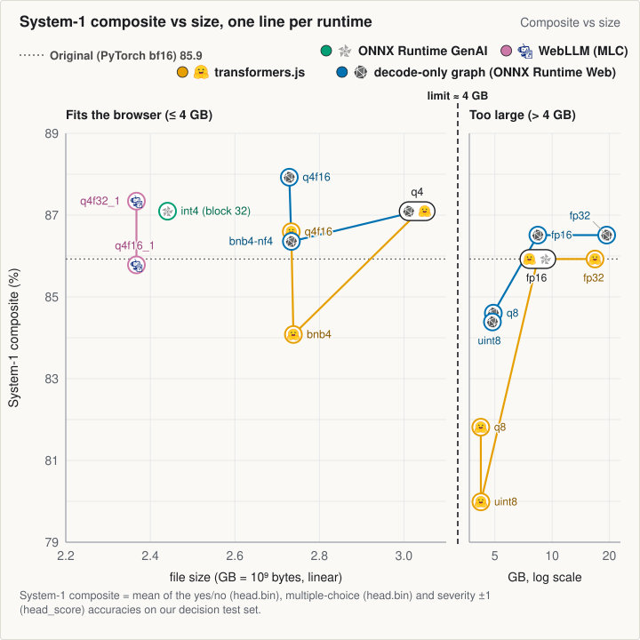
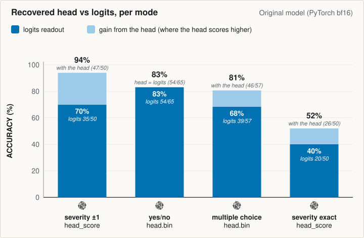
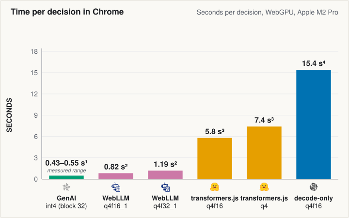

# System-1 at the Edge: One-Pass Security Decisions of a 4B Model in the Browser on Four Runtimes

**Eduardo Worrel**

## Abstract

Security checks often look at material that should not leave the user's machine: the source of a page, internal code, logs. A model that runs inside the web browser keeps that material local, needs no server and costs nothing per question. CT0-Micro, the first model of the CT0 architecture [1] (about 4 billion parameters, released as alias3-micro-1026), is a natural candidate: in its System-1 mode it answers a typed security question (yes/no, multiple choice or severity) in a single pass, without writing text. We ask whether those quick answers survive the compression needed to fit in a browser. We publish CT0 builds for four runtimes and compare each with the original model on the same 172 questions. The answer is mostly yes. Only 4-bit builds fit in the browser. They score the same as the original, but each answers some questions differently, and our test is only large enough to catch big drops in accuracy. Speed depends on the runtime, from about half a second to about fifteen seconds per answer. Along the way we recover CT0's official decision head from a damaged release file, add a small severity reader as a proof of concept, and find that asking one question per vulnerability class improves detection on real code. Browser timings come from a single machine.

## 1 Introduction

CT0 [1] is an architecture for compact cybersecurity transformers. Its first model, CT0-Micro, is released as `alias3-micro-1026`; this paper studies that model, and below “CT0” refers to it. It has two modes that share the same weights. System 2 is an agent that uses tools and writes text. System 1 answers one typed security question in a single *forward pass*, one run of the model over the prompt. It can read the answer in two ways. The first uses the *logits*, the model's score for each possible next word. The second uses a *head*, a small extra layer that reads the model's internal state and picks an answer.

One forward pass is cheap, so a System-1 answer could run inside a web page, on the user's own machine, without sending the material under test to a server. It also reads a single position, so it may tolerate low numeric precision that breaks long text generation. The CT0 paper tests System 1 at full precision (bf16) on a server GPU. It leaves two questions for later work: the effect of *quantization* (storing the weights with fewer bits), and how the head compares with the logits. It does not cover running on the user's own device.

In the browser, the main obstacle is CT0's vocabulary of 248,320 tokens. The *embedding*, the table that turns each token into numbers, takes 2.54 GB in fp32 on its own. ONNX Runtime Web allows about 4 GB per weight file [2]. Our contributions are:

1. **Agreement with the original model.** We test four runtimes and up to seven precisions. None of 180 paired tests is significant, before or after Holm correction. We also count *flips*: questions where the compressed model gives a different answer than the original. The builds are published in five public Hugging Face repositories.
2. **Head versus logits, per mode.** We recover CT0's head from a damaged release file and add a separate severity reader as a proof of concept (Section 4). We compare them with the logits on the decision test set. These are results for the recovered head on our prompt template, not for the official System 1.
3. **Practical deployment findings.** One 8-bit scheme gives unstable answers. Half-precision arithmetic in MLC shifts the internal state. The browser's per-file limit forces large files to be split. On real code, asking one question per vulnerability class helps.

## 2 Related Work

This section places our work next to four lines of research.

**Reading answers from inside the model.** CT0's System 1 [1] trains a head on the internal state instead of generating the answer as text. Li et al. [3] do the same for text classification. Reading probabilities directly and asking the model in words can give different answers [4]. Small classifiers trained on internal states, called *probes*, can know more than the output shows, but they transfer poorly across datasets [5]. Yu et al. [6] use “System 1” for answering without intermediate reasoning text, after distillation. Where the CT0 paper's System-1 results overlap with ours, they point the same way. System 1 is weaker than System 2 on severity, and typed questions beat one raw question. But those results come from other tasks, a server GPU and the complete head.

**Quantization and individual answers.** A compressed model can keep its accuracy and still change many individual answers [7]. That is why we report flips next to McNemar tests. Confidence drops mostly where the full model was already unsure [8]. The effect on internal states depends on the method and the bit width [9].

**Running models on the device.** Several runtimes run LLMs in the browser, mostly on WebGPU, the browser's interface to the GPU: ONNX Runtime Web [2] and GenAI [10], Transformers.js [11], WebLLM/MLC [12, 13] and LlamaWeb [14]. On WebGPU, launching GPU work dominates when tokens are generated one at a time [15]. Measurement studies cover browsers [16] and phones [17]; they report speed, memory and energy, not whether the device build gives the original model's answers. **Security models.** Foundation-Sec-8B is evaluated at full precision [18]. AQUA-LLM reports a quantization loss on cybersecurity questions answered by text generation [19].

## 3 Method

This section describes the model, the runtimes, the test set, and how we read and compare answers.

**Model and runtimes.** We use `aliasrobotics/alias3-micro-1026` at revision `61c0e710` [20], the CT0-Micro release described by Mayoral-Vilches et al. [1]. It is a `qwen3_5_text` model [21]. A *build* is a converted copy of the model for one runtime at one precision. Our builds run on four runtimes: ONNX Runtime GenAI [10], WebLLM/MLC [13], transformers.js [11], and the decode-only graph (ONNX Runtime Web) [2]. The decode-only graph handles one token per call, so we feed it the prompt token by token. One library (ct0-edge) drives all four; they differ only in graph and runtime. Browser runs use Chrome with WebGPU on one Apple M2 Pro. Server runs use ONNX Runtime on NVIDIA GPUs.

**Test set and reference.** Our decision test set, which we wrote for this study and which is not part of the CT0 release, has 172 questions: 65 yes/no, 57 multiple choice and 50 severity (1–5). We compare every build with the original model, “Original (PyTorch bf16)”. It runs through Transformers with the same prompts, positions and reads as the builds (checked on 172 of 172 questions).

**Statistics.** For each mode and read we run an exact McNemar test. It asks whether the build and the original get different questions right more often than chance explains. There are 180 such tests on published builds. We correct them for multiple testing with Holm–Bonferroni. We also report the *flip rate*: the share of the 172 questions where the build's answer differs from the original's, per read. Accuracies carry 95% bootstrap confidence intervals.

**Two ways to read an answer.** The logits read compares the scores for *Yes* and *No*, for the first token of each option, or for the digits 1–5. The head read uses two small files that run as plain JavaScript on the model's internal state. `head.bin` is CT0's head, recovered from a damaged release file. `head_score.bin` is a new reader for severity. Section 4 explains both.

**One summary number.** The *System-1 composite* is the average of three accuracies: yes/no and multiple choice with `head.bin`, and severity within ±1 level with `head_score.bin`.

**Our prompt template.** CT0 marks parts of the prompt with special markers. The mapping from these markers to token ids is not published. We therefore write the markers as plain text in our own template. All head results describe the recovered head on this template (Table A1).

## 4 The heads: recovering CT0's head and adding a severity reader

This section explains how we rebuilt CT0's official head from a damaged file, what it can and cannot do, and how we added a separate file for severity.

**Why the official head does not open.** The official repository ships the head as `head.pt` (4,961,280 bytes). The file does not open: both `torch.load` and a standard zip reader fail. It has the same size in every commit of the repository, and no complete copy exists anywhere public. A `.pt` file is a zip archive. This one was written in streaming mode (flag 0x0808), which stores each block's size after the block instead of in an index. The upload stopped partway through the third tensor; a *tensor* is one array of numbers. Seven internal entries had started. The entry that describes the structure (`data.pkl`, 3,553 bytes) is complete.

**What the head is.** That description shows a very simple head. It scores an answer as the product of two projections of the internal state *h*: score = q(*h*)·k(*h*). It has only four tensors: `q.weight` (256×2560), `q.bias` (256), `k.weight` (256×2560) and `k.bias` (256). The saved settings are head_dim 256, temperature 2.0 and head_lr = 0.0, the head's learning rate.

**How we recovered it.** We read the zip byte stream by hand and pulled out every tensor that was there (Table 1). All 583,648 recovered numbers are finite. `k.weight` has the same spread as `q.weight` (standard deviation 0.011417 vs 0.011408). The byte order is little-endian, as expected. The 29 missing rows of `k.weight` cannot be rebuilt: they have no simple structure, and k cannot be predicted from q. We leave them at zero.

**Table 1:** *How much of each part of CT0's head we recovered from the damaged `head.pt`. CRC is the zip file's own checksum. Takeaway: q is complete, most of `k.weight` survives, and `k.bias` is lost.*

| Tensor | Shape | Recovered |
|---|---|---|
| `q.weight` | 256×2560 | 100% (CRC matches) |
| `q.bias` | 256 | 100% (CRC matches) |
| `k.weight` | 256×2560 | 89.1% (227 of 256 rows complete, plus 2528 of 2560 values of row 228) |
| `k.bias` | 256 | 0% (lost) |

**Replacing the lost bias.** head_lr = 0.0 means that q and k were not trained in that run. They act as a fixed projection. In that case the missing `k.bias` only shifts every score by the same constant. So one offset can replace it. We take the median score over 8 unlabeled base prompts, −16.27, and add +16.27 to every score. This step uses no labels.

**Where the head reads, and how we checked it.** The official paper does not say at which positions the head reads. We found them by trying more than 200 combinations. q reads at the `<decide>` marker. k reads at the last prompt position for yes/no, and at each `</opt>` marker for multiple choice. Normalizing the internal state made results worse. The temperature only scales the scores. On yes/no the recovered head is right on 16 of 16 prompts (8 base and 8 held out), and its scores have a correlation of 0.984 with the logits decision. We release it as `head.bin` (2.6 MB, fp16). It runs in plain JavaScript in 1.18 ms per call, against 522 ms for one forward pass of the model.

**Why it cannot rank severity.** The recovered head does not put severity levels in order. Across more than 34 settings (positions, offsets, normalization, temperature), the best result was 5 of 7. That result came from the threshold, not from telling levels apart. This is expected: an untrained projection has no reason to encode a 1-to-5 scale.

**A severity direction exists.** We first checked whether severity is visible inside CT0 at all. We took the difference between the average internal state of severe cases (level 3 or higher) and of mild ones (below 3). Scoring new cases along this direction ranks them by severity. On 30 new cases, split 15 for fitting and 15 for testing over 200 random splits, the Spearman rank correlation on the test half is 0.83–0.84. With shuffled labels it is about −0.02.

**How `head_score.bin` is built.** `head_score.bin` is a *ridge regression*, a straight-line fit with a penalty that keeps the weights small (λ = 10, chosen by leave-one-out). It maps the internal state at the last prompt position to a severity level from 1 to 5. It is fitted on 30 labelled cases, 6 per level. We store it in exactly `head.bin`'s format: it uses 2 of the 256 rows, and the rest are zero. So the same JavaScript code runs both files. The stored version differs from the full-precision fit by 0.00086. A fixed scale α = 1.1, set in advance from the level thresholds, turns the output into a level.

**How well it works.** On held-out cases (15 for fitting, 15 for testing, 300 splits) it reaches a Spearman correlation of 0.849. It gives the exact level 0.448 of the time and is within ±1 level 0.970 of the time. With shuffled labels it drops to chance: Spearman −0.037, exact 0.207. Always answering “3” gives 0.20 exact. On the 50 severity questions of the test set, never used for fitting, the original model with `head_score.bin` is exact 0.52 of the time and within ±1 0.94 of the time. The logits reach 0.40 and 0.70. The official paper advises against re-fitting the head on your own labels. We keep `head.bin` unchanged for yes/no and multiple choice. `head_score.bin` is a second, separate file used only for severity.

**Scope of `head_score.bin`.** `head_score.bin` is a proof of concept. It shows that CT0's internal state carries a severity direction, and that a reader for it fits inside the head's own file format. It was fitted on 30 synthetic cases and tested on 50 synthetic questions; using it as a severity scorer calls for a larger, independently labelled set.

## 5 Results

### 5.1 Agreement with the original model

This section shows that no published build is detectably less accurate than the original, although 4-bit builds change many individual answers.

None of the 180 paired tests has *p*&lt;0.05; the smallest is *p* = 0.0625. So none remains after Holm–Bonferroni. Both ONNX fp32 builds match the original within one answer per read.

Flip rates show differences that accuracy hides. The fp16 and fp32 builds change 0.6–2.3% of answers. The published 4-bit builds change 5.8–13.4% with the logits and 12.2–19.8% with the head. The *dynamic W8A8* builds, which also turn the intermediate values into 8-bit numbers while running, change up to 28.5%. Most head flips fall on the border between two severity levels (for example, 14 of 21 for decode-only q4f16).

**Figure 1:** *System-1 composite against weight-file size. The composite is the average of yes/no and multiple-choice accuracy with `head.bin` and severity within ±1 with `head_score.bin`. Left panel: builds that fit the browser (≤ 4 GB); right panel: builds that do not. Dotted line: the original model (PyTorch bf16). Takeaway: fewer bits do not lower the score; the lowest points are the dynamic W8A8 builds.*

**Table 2:** *Builds that fit the browser, compared with the original model. Comp. = System-1 composite. Flips = % of the 172 questions where the build's answer differs from the original's (logits read / head read). Last column: smallest McNemar p, before correction. Per-mode counts: Table A2. Takeaway: 4-bit builds change many individual answers, but no accuracy difference is detectable with this many questions.*

First row: the original, as reference. Other rows by composite, highest first; the differences between them are not statistically significant.

Key: rows marked ‡ = consistent but not significant loss, or unstable; † in the GB column = does not fit the browser; unmarked rows = no significant change vs original; the first row is the original model (reference).

| # | Runtime · build | GB | Comp. | Flips l / h (%) | McNemar vs original |
|---|---|---|---|---|---|
| – | **Original (PyTorch bf16)** | — | 0.859 | — | reference |
| 1 |  decode-only q4f16 | 2.73 | 0.879 | 12.8 / 12.2 | *p*=0.25 (−3, severity) |
| 2 |  WebLLM q4f32_1 | 2.37 | 0.873 | 13.4 / 14.0 | *p*=0.25 (+3, severity) |
| 3 |  GenAI int4 (block 32) | 2.44 | 0.871 | 11.6 / 14.5 | *p*=0.73 (+2, mult. choice) |
| 4 |  decode-only q4 | 3.03 | 0.871 | 10.5 / 14.5 | *p*=0.50 (−2, severity) |
| 5 |  transformers.js q4 | 3.04 | 0.871 | 10.5 / 14.5 | *p*=0.73 (+2, mult. choice) |
| 6 |  transformers.js q4f16 | 2.73 | 0.866 | 9.9 / 14.5 | *p*=1 |
| 7 |  decode-only bnb4-nf4 | 2.73 | 0.864 | 6.4 / 12.2 | *p*=0.13 (+5, mult. choice) |
| 8 |  WebLLM q4f16_1 | 2.37 | 0.858 | 10.5 / 19.8 | *p*=0.25 (−3, severity) |
| 9 |  transformers.js bnb4 | 2.74 | 0.841 | 5.8 / 12.8 | *p*=0.062 (+5, mult. choice) |

### 5.2 Head versus logits

This section compares the two ways of reading an answer.

On yes/no the recovered head ties the logits: across published builds, the logits get 51–55 questions right and the head 51–56. On multiple choice the head is ahead on the original model: 0.81 [0.70, 0.91] against 0.68 [0.56, 0.81]. On severity `head_score.bin` is ahead too: 0.52 exact and 0.94 within ±1, against 0.40 and 0.70 for the logits. The confidence intervals overlap, and we ran no paired test.

**Figure 2:** *Accuracy per mode on the original model with our prompt template: logits (dark) and recovered head (light, shown where higher). Sorted by head accuracy. Takeaway: a tie on yes/no; the head is ahead on multiple choice and severity, without a paired test.*

### 5.3 Browser feasibility and deployment findings

This section shows which builds fit the browser, how fast they answer, and four practical findings.

Every build that fits is 4-bit with a quantized embedding, at 2.37–3.04 GB. Among them, one answer takes from 0.43–0.55 s to about 15 s, depending on the runtime (Figure 3). Some builds ran in Chrome and on a server with the same files. Their answers almost always match. Decode-only q4 and q4f16 differ on 0 rows, and transformers.js bnb4 gives the same answer on all 172 questions. GenAI int4 gives the same answers on 159 of 172 questions (380 of 394 individual decisions); the 14 differences are close calls, which fits the half-precision arithmetic it uses on WebGPU.

**Figure 3:** *Time per System-1 answer in Chrome (WebGPU, one Apple M2 Pro), fastest first. Light segment: upper end of a measured range. ¹ other session; ² median time to read the prompt, shared machine; ³ median per question, runs slowed by other jobs dropped (q4f16: the 70 questions run without them); ⁴ median per question over all 172 questions, GPU sharing during the run not recorded. Takeaway: runtimes differ in speed by more than ten times, with no detectable accuracy difference among these builds.*

- **Dynamic W8A8 is unstable.** The transformers.js q8 and uint8 builds give different results on different execution providers and machines. On one item, P(Yes) was 0.4553, 0.5525 and 0.4652. The decode-only q8 build, which quantizes only the weights, does not have this problem.
- **Half-precision arithmetic shifts MLC's internal state.** WebLLM q4f16_1 computes intermediate values in fp16. Its internal state at the last position has a cosine similarity of 0.86 with the original's, against 0.98 for q4f32_1. We found no detectable accuracy loss.
- **The per-file limit forces splitting.** transformers.js q4 and q4f16 fail as one weight file. They load when split into files below 2 GB. GenAI needs its WebGPU bundle; without it, 591 graph nodes silently fall back to the CPU.
- **Generated text drifts, answers do not.** Every 4-bit build produces different tokens from fp32 within two steps of free generation. Yet each keeps its System-1 answers.

### 5.4 Question format on real code

This section shows that the way the question is asked matters on real code.

We use a real-code set of 161 JavaScript items. Their labels come mechanically from CodeQL's security tests [22] and OWASP Juice Shop [23]. We measure *AUROC*, how well a score separates vulnerable from safe code (0.5 is chance, 1 is perfect). One option is to ask a single generic question: “is this code vulnerable?”. The other is to ask once per vulnerability class and keep the highest score. Asking per class raises the logits AUROC from 0.807 to 0.847, and `head.bin`'s from 0.764 to 0.831, with no training (Table A3).

## 6 Limitations

This section lists what our data cannot show.

- **Small sample.** There are 65, 57 and 50 questions per mode, and 161 real-code items. An exact McNemar test needs at least 6 questions where the two models disagree. So only accuracy changes of 9–12% or more are detectable.
- **Synthetic data, one annotator.** The questions are synthetic. Severity labels come from one author (Claude).
- **Severity reader.** `head_score.bin` is a proof of concept, fitted and tested on synthetic cases; its severity results, including the severity part of the System-1 composite, are indicative.
- **One machine.** Browser times come from a single Apple M2 Pro and were not repeated under controlled conditions. Each runtime was timed with its own script, so comparisons between runtimes mix the effect of the runtime and of the graph.
- **Adapted interface.** We use plain-text markers, our own reads and a partly recovered head. Head results are not results for the official System 1.

## 7 Conclusion

This section states what the results mean.

As far as this test set can tell, CT0's System-1 answers survive the move to the browser. Accuracy holds, but 4-bit builds change a real share of individual answers, and only large losses are detectable at this sample size. The vocabulary decides which builds fit the browser; the runtime decides how fast they answer. Most of CT0's head can be recovered from the damaged release file, and a second small file in the same format can read severity. On real code, asking one question per vulnerability class helps CT0 without training. Fixes to the tools, per-build generation tables and the relation to the official CT0 results are in the model cards. Per-question results and scripts are kept by the authors and available on request.

*Note (November 2026). An earlier draft, shared privately, printed 9–14 s for decode-only q4f16 in Figure 3, a value its measurement files do not support; the measured value is 15.4 s per question. No other number changed.*

## References

- [1] Mayoral-Vilches, V. and Alias Robotics (2026). *CT0: Cybersecurity Transformer*. arXiv:2610.16550.
- [2] Microsoft (n.d.-a). *ONNX Runtime* (incl. onnxruntime-web). `github.com/microsoft/onnxruntime`
- [3] Li, Z., Li, X., Liu, Y., Xie, H., Li, J., Wang, F., Li, Q., and Zhong, X. (2023). Label Supervised LLaMA Finetuning. arXiv:2310.01208.
- [4] Hu, J. and Levy, R. (2023). Prompting is not a substitute for probability measurements in large language models. *EMNLP 2023*. arXiv:2305.13264.
- [5] Orgad, H., Toker, M., Gekhman, Z., Reichart, R., Szpektor, I., Kotek, H., and Belinkov, Y. (2024). LLMs Know More Than They Show: On the Intrinsic Representation of LLM Hallucinations. arXiv:2410.02707.
- [6] Yu, P., Xu, J., Weston, J., and Kulikov, I. (2024). Distilling System 2 into System 1. arXiv:2407.06023.
- [7] Dutta, A., Krishnan, S., Kwatra, N., and Ramjee, R. (2024). Accuracy is Not All You Need. *NeurIPS 2024*. arXiv:2407.09141.
- [8] Proskurina, I., Brun, L., Metzler, G., and Velcin, J. (2024). When Quantization Affects Confidence of Large Language Models? *Findings of NAACL 2024*. arXiv:2405.00632.
- [9] Wang, Q., Wang, M., Feldhus, N., Ostermann, S., Cao, Y., Schütze, H., Möller, S., and Schmitt, V. (2026). Through a Compressed Lens: Investigating The Impact of Quantization on Factual Knowledge Recall. *TrustNLP @ ACL 2026*. arXiv:2505.13963.
- [10] Microsoft (n.d.-b). *onnxruntime-genai*. `github.com/microsoft/onnxruntime-genai`
- [11] Hugging Face (n.d.). *Transformers.js*. `github.com/huggingface/transformers.js`
- [12] Ruan, C. F., Qin, Y., Parthasarathy, A. R., et al. (2024). WebLLM: A High-Performance In-Browser LLM Inference Engine. arXiv:2412.15803.
- [13] MLC AI (n.d.). *WebLLM* / *MLC-LLM*. `github.com/mlc-ai/web-llm`
- [14] Levine, R., Sharma, R., Jain, N., Ramesh, A., Chen, Z., Abbas, N., Contini, J., and Sorensen, T. (2026). Llamas on the Web: Memory-Efficient, Performance-Portable, and Multi-Precision LLM Inference with WebGPU. arXiv:2605.20706.
- [15] Maczan, J. (2026). Characterizing WebGPU Dispatch Overhead for LLM Inference Across Four GPU Vendors, Three Backends, and Three Browsers. arXiv:2604.02344.
- [16] Wang, Q., Jiang, S., Chen, Z., Cao, X., Li, Y., Li, A., Ma, Y., Cao, T., and Liu, X. (2024). Anatomizing Deep Learning Inference in Web Browsers. *ACM TOSEM*. arXiv:2402.05981.
- [17] Laskaridis, S., Katevas, K., Minto, L., and Haddadi, H. (2024). MELTing point: Mobile Evaluation of Language Transformers. *MobiCom 2024*. arXiv:2403.12844.
- [18] Kassianik, P., Saglam, B., Chen, A., et al. (2025). Llama-3.1-FoundationAI-SecurityLLM-Base-8B Technical Report. arXiv:2504.21039.
- [19] Gungor, O., Sood, R., Wang, H., and Rosing, T. (2025). AQUA-LLM: Evaluating Accuracy, Quantization, and Adversarial Robustness Trade-offs in LLMs for Cybersecurity Question Answering. *ICMLA 2025*. arXiv:2509.13514.
- [20] Alias Robotics (n.d.). *alias3-micro-1026* (CT0). Model card. `huggingface.co/aliasrobotics/alias3-micro-1026`
- [21] Qwen Team (n.d.). *Qwen3.5* model family. `huggingface.co/Qwen/Qwen3.5-4B`
- [22] GitHub (n.d.). *CodeQL*. `github.com/github/codeql`
- [23] OWASP (n.d.). *OWASP Juice Shop*. `github.com/juice-shop/juice-shop`

Runtime logos in figures and tables only identify the runtime (nominative use). They belong to their owners and imply no endorsement.

## Appendix

The tables below support the main claims. Flip rates and the Holm correction come from the per-question results of each build against the original, with no new measurement; all other numbers are in the model cards or in the authors' per-question results, available on request.

### A Protocol and reads

**Table A1:** *Evaluation protocol and reads. Takeaway: every build is compared with the same original model, on the same prompts and reads.*

| Item | Detail |
|---|---|
| **Decision test set (ours)** | 172 security questions with known answers, written by us for this study (not part of the CT0 release): **65** yes/no, **57** multiple-choice (chance 0.272), **50** severity (1–5; 10 per level, rubric labels, excluded from `head_score.bin` training). Called the “decision test set” below. |
| **Statistics** | *k*/*n*, 95% bootstrap CI (2000 resamples, seed 20261025); tie-aware Spearman; exact McNemar against the original model (PyTorch bf16), the reference for every System-1 comparison; Holm–Bonferroni over the 180 tests on shipped builds; flip rate = share of the 172 questions whose decision differs from the original, per read |
| **Original model** | “Original (PyTorch bf16)”: `aliasrobotics/alias3-micro-1026` at revision `61c0e710`, the revision our builds come from, run in PyTorch bf16 through Transformers with one full forward pass per question. It reuses the same prompts, positions and reads as every other row (verified 172/172). |
| **Scope** | 18 shipped builds · 180 paired tests against the original |
| **`head.bin`** | 2.6 MB fp16; **1.18 ms** per call vs 522 ms per forward; does not order severity (5/7 from the threshold; 34+ configurations ≤ 5/7) |
| **`head_score.bin`** | ridge probe (λ=10, α=1.1 a priori); 30-item hold-out: Spearman **0.849**, exact 0.448, ±1 0.970; shuffled labels −0.037; proof of concept |
| **Reads** | yes/no: *Yes* vs *No* logit at the last position; head: pointer score, q at `<decide>`, k at the last position with a fitted offset. Multiple choice: first token of each `<opt>`; head: q at `<decide>`, k at each `</opt>`. Severity: argmax over the digits 1–5; head: `head_score.bin` raw value → level. |
| **Adapted interface** | markers written as plain text in our own ChatML template (the marker-to-id mapping and the Choice criteria format are not published); `head.bin` recovered from a truncated release file (100% of `q`, 89.1% of `k.weight`, `k.bias` missing) |

### B Full quality table against the original

**Table A2:** *System-1 accuracy of every build: correct answers with logits / `head.bin` for yes/no (65) and multiple choice (57); `head_score.bin` exact · ±1 for severity (50). GB = 109 bytes. Comp. = System-1 composite. Flips = % of the 172 questions whose decision differs from the original, logits read / head read. Last column: smallest McNemar p against the original, with the change in correct answers and its mode. Takeaway: no build differs significantly from the original; flip rates separate the precisions.*

First row: the original model, as reference. Other rows sorted by the composite, highest first; ties: smaller file first.

Key: rows marked ‡ = consistent but not significant loss, or unstable; † in the GB column = does not fit the browser; unmarked rows = no significant change vs original; the first row is the original model (reference).

| # | Runtime · build | GB | yes/no l / h | mult. choice l / h | severity ex · ±1 | Comp. | Flips l / h (%) | McNemar vs original |
|---|---|---|---|---|---|---|---|---|
| – | **Original (PyTorch bf16)** | — | 54 / 54 | 39 / 46 | 26 · 47 | 0.859 | — | reference |
| 1 |  decode-only q4f16 | 2.73 | 53 / 54 | 38 / 46 | 24 · 50 | 0.879 | 12.8 / 12.2 | *p*=0.25 (−3, severity) |
| 2 |  WebLLM q4f32_1 | 2.37 | 54 / 54 | 38 / 45 | 22 · 50 | 0.873 | 13.4 / 14.0 | *p*=0.25 (+3, severity) |
| 3 |  GenAI int4 (block 32) | 2.44 | 55 / 54 | 38 / 48 | 26 · 47 | 0.871 | 11.6 / 14.5 | *p*=0.73 (+2, mult. choice) |
| 4 |  decode-only q4 | 3.03 | 55 / 54 | 39 / 48 | 26 · 47 | 0.871 | 10.5 / 14.5 | *p*=0.50 (−2, severity) |
| 5 |  transformers.js q4 | 3.04 | 55 / 54 | 39 / 48 | 26 · 47 | 0.871 | 10.5 / 14.5 | *p*=0.73 (+2, mult. choice) |
| 6 |  transformers.js q4f16 | 2.73 | 55 / 54 | 38 / 46 | 26 · 48 | 0.866 | 9.9 / 14.5 | *p*=1 |
| 7 |  decode-only fp16 | 8.42 † | 54 / 54 | 39 / 47 | 27 · 47 | 0.865 | 1.2 / 1.2 | *p*=1 |
| 8 |  decode-only fp32 | 19.37 † | 54 / 54 | 39 / 47 | 26 · 47 | 0.865 | 1.2 / 0.6 | *p*=1 |
| 9 |  decode-only bnb4-nf4 | 2.73 | 55 / 55 | 44 / 47 | 30 · 46 | 0.864 | 6.4 / 12.2 | *p*=0.13 (+5, mult. choice) |
| 10 |  transformers.js fp16 | 8.42 † | 54 / 54 | 38 / 46 | 26 · 47 | 0.859 | 0.6 / 2.3 | *p*=1 |
| 11 |  GenAI fp16 | 8.48 † | 54 / 54 | 38 / 46 | 26 · 47 | 0.859 | 0.6 / 2.3 | *p*=1 |
| 12 |  transformers.js fp32 | 16.83 † | 54 / 54 | 38 / 46 | 26 · 47 | 0.859 | 0.6 / 2.3 | *p*=1 |
| 13 |  WebLLM q4f16_1 | 2.37 | 52 / 56 | 38 / 44 | 25 · 47 | 0.858 | 10.5 / 19.8 | *p*=0.25 (−3, severity) |
| 14 |  decode-only q8 | 4.91 † | 54 / 55 | 40 / 44 | 27 · 46 | 0.846 | 2.9 / 3.5 | *p*=0.50 (−2, mult. choice) |
| 15 |  decode-only uint8 | 4.85 † | 55 / 51 | 37 / 46 | 22 · 47 | 0.844 | 8.7 / 14.0 | *p*=0.25 (−3, yes/no) |
| 16 |  transformers.js bnb4 | 2.74 | 55 / 53 | **44** / 46 | 31 · 45 | 0.841 | 5.8 / 12.8 | *p*=0.062 (+5, mult. choice) |
| 17 ‡ |  transformers.js q8 | 4.22 † | 51 / 52 | 40 / 43 | 20 · 45 | 0.818 | 13.4 / 22.7 | *p*=0.13 (−4, severity) |
| 18 ‡ |  transformers.js uint8 | 4.22 † | 54 / 53 | 39 / 39 | 22 · 45 | 0.800 | 14.5 / 28.5 | *p*=0.13 (−4, severity) |

### C Question format on real code

**Table A3:** *Question format on real code (real-code set, 161 JavaScript items, labels taken mechanically from CodeQL security tests and OWASP Juice Shop): AUROC of CT0's own reads with 95% cluster-bootstrap CI, original model, no training. Takeaway: one question per class beats one generic question for both reads.*

Rows sorted by AUROC, highest first.

| Read | Question format | AUROC [95% CI] |
|---|---|---|
| CT0 logits | one question per class + max | 0.847 [0.763, 0.918] |
| CT0 `head.bin` | one question per class + max | 0.831 [0.747, 0.903] |
| CT0 logits | generic question | 0.807 [0.718, 0.895] |
| CT0 `head.bin` | generic question | 0.764 [0.670, 0.855] |

